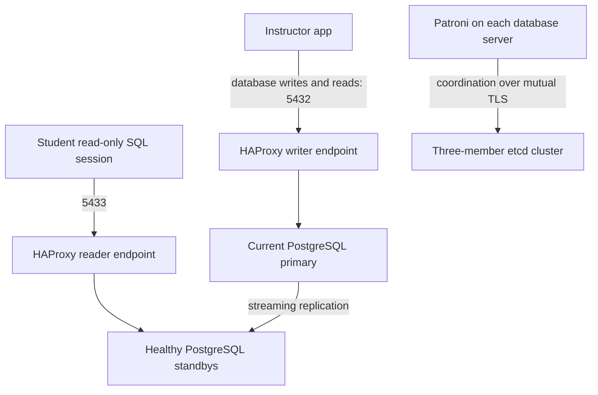

# Patroni HA — classroom guide

Build the database cluster on prepared servers, then connect the instructor's application.

**Start with [1. Prepare your worksheet](01-prepare.md).** Run one command at a time. Every configuration step names the server, provides the file contents and explains how to check the result.

## Who does what?

| Students | Instructor |
|---|---|
| Configure three etcd members | Provision servers and install software/dependencies |
| Configure three PostgreSQL/Patroni members | Supply working networking, TLS certificates and access |
| Configure one HAProxy router | Install and configure Mattermost on the app server |
| Create the app database and verify replication | Connect the app to the student router and provide the app URL |
| Test the app and practice a switchover | Verify the app before handing it over |

## Follow this order

**Before step 1:** the instructor provisions the servers, completes the [software preparation](sysadmin-installation.md), installs the [runtime-directory correction](03-patroni.md#prepare-the-service-to-survive-a-reboot), and verifies certificates. Students begin with installed software and an unconfigured database stack.

| Milestone | Work | Finish when |
|---|---|---|
| 1 | [Prepare](01-prepare.md) | Server addresses and prerequisites are confirmed |
| 2 | [etcd](02-etcd.md) | Three endpoints report healthy |
| 3 | [Patroni](03-patroni.md) | One leader and two streaming replicas |
| 4 | [HAProxy](04-haproxy.md) | Valid configuration and running router |
| 5 | [Application database](05-app-database.md) | Role, password and database created |
| 5b | [Standby routing](05b-readonly-routing.md) | Reads reach replicas; writes are rejected |
| 6 | [Verify and receive the app](06-verify.md) | Replication and browser checks succeed |
| 7 | [Planned switchover](07-switchover.md) | New leader, same router, working app |
| 8 | [Failure and recovery](08-failure-recovery.md) | Database, node and service failures recover with working app |

[Read logs and understand settings](08-troubleshooting.md) when a check fails.

## Connection path

## The two addresses

- **Database router IP:** the instructor puts this in the app's database connection.
- **App IP / URL:** students use this to open the app in a browser.

The app IP does not go into the Patroni member list or HAProxy database backends. PostgreSQL sees the router as its client in this topology. The instructor manages any app-to-router network allowlist.

## Instructor material

- [Prepare and connect the app](instructor-app.md)
- [Software installation reference](sysadmin-installation.md)
- [Download the complete plain-text manual](patroni-ha-class-steps.txt)

## Tested on a real lab

**Yes. The configurations and operations were executed on a fresh eight-node AWS lab on September 9, 2026 (Pacific).** We tested replication, writer/standby routing, real Mattermost writes, switchover, PostgreSQL failure, server stop/start and Patroni-service stop.

Testing found an expired certificate, retained app connections after switchover and a missing socket directory after reboot. The guide contains the corrections, and the affected experiments were repeated.

[Read the measured results and limits](TEST-RESULTS.md). All 470 acknowledged test messages remained readable. Transient failed requests are documented; this is not a claim of seamless failover or guaranteed zero data loss.

Use your assigned addresses and private passwords in the worksheets. The instructor provisions fresh software-ready servers for class; the tested rehearsal cluster is separate from that clean starting state.
