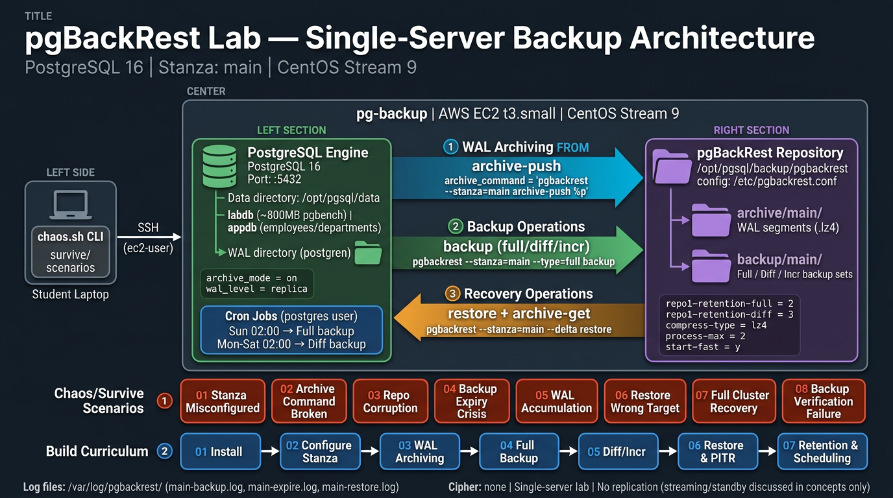

# pgBackRest Lab - Single-Server Backup Architecture

PostgreSQL 16 | Stanza: main | CentOS Stream 9

Learn enterprise-grade PostgreSQL backup management using pgBackRest. This project takes you from installation through full and incremental backups, point-in-time recovery, retention policies, and real-world failure scenarios.

---

## Architecture



Single-server setup - PostgreSQL engine and pgBackRest repository live on the same machine. Three core operations flow between them:

1. **WAL Archiving** (archive-push) - PostgreSQL ships completed WAL segments to the pgBackRest repository via `archive_command`. This runs continuously in the background.
2. **Backup Operations** (full/diff/incr) - pgBackRest reads the data directory and creates compressed backup sets in the repository. Scheduled via cron (Sun 02:00 full, Mon-Sat 02:00 diff).
3. **Recovery Operations** (restore + archive-get) - pgBackRest restores backup files to the data directory and replays archived WAL segments for point-in-time recovery.

### Server Layout

```
pg-backup (AWS EC2 t3.small | CentOS Stream 9)
├── PostgreSQL Engine                    pgBackRest Repository
│   Port: 5432                           /opt/pgsql/backup/pgbackrest/
│   Data: /opt/pgsql/data               ├── archive/main/
│   WAL:  /opt/pgsql/data/pg_wal/       │   └── WAL segments (.lz4)
│   ├── labdb (~800MB pgbench)           └── backup/main/
│   └── appdb (employees/departments)        └── Full/Diff/Incr backup sets
│
│   archive_mode = on                    Config: /etc/pgbackrest.conf
│   wal_level = replica                  repo1-retention-full = 2
│                                        repo1-retention-diff = 3
│   Cron Jobs (postgres user)            compress-type = lz4
│   Sun 02:00 -> Full backup             process-max = 2
│   Mon-Sat 02:00 -> Diff backup         start-fast = y
│
└── Log files: /var/log/pgbackrest/
    (main-backup.log, main-expire.log, main-restore.log)
```

---

## Server Details

| Property | Value |
|---|---|
| **Hostname** | pg-backup |
| **OS** | CentOS Stream 9 |
| **Instance type** | t3.small (2 vCPU, 2 GB RAM) |
| **PostgreSQL** | 16 |
| **PGDATA** | `/opt/pgsql/data` |
| **WAL directory** | `/opt/pgsql/data/pg_wal/` (postgres-managed) |
| **pgBackRest repo** | `/opt/pgsql/backup/pgbackrest` |
| **pgBackRest config** | `/etc/pgbackrest.conf` |
| **pgBackRest logs** | `/var/log/pgbackrest/` |
| **Stanza name** | `main` |
| **Databases** | `labdb` (~800 MB pgbench), `appdb` (employees/departments) |
| **Key settings** | `archive_mode=on`, `wal_level=replica` |
| **Cipher** | none (single-server lab) |
| **Replication** | none (streaming/standby discussed in concepts only) |

---

## BUILD Guides

Step-by-step instructions to set up pgBackRest from scratch. Complete these in order.

| # | Guide | Estimated Time |
|---|---|---|
| 01 | [Install pgBackRest](build/01-install-pgbackrest.md) | 20 min |
| 02 | [Configure Stanza](build/02-configure-stanza.md) | 20 min |
| 03 | [WAL Archiving](build/03-wal-archiving.md) | 25 min |
| 04 | [Full Backup](build/04-full-backup.md) | 20 min |
| 05 | [Differential and Incremental Backups](build/05-differential-incremental.md) | 30 min |
| 06 | [Restore and Point-in-Time Recovery](build/06-restore-and-pitr.md) | 40 min |
| 07 | [Retention Policies and Scheduling](build/07-retention-and-scheduling.md) | 25 min |
| | **Total** | **~3 hours** |

---

## USE Exercises

Hands-on practice using pgBackRest in realistic scenarios. Requires completed BUILD guides.

| # | Exercise | Estimated Time |
|---|---|---|
| 01 | [Backup Inventory](use/01-backup-inventory.md) | 20 min |
| 02 | [WAL Archiving Health](use/02-wal-archiving-health.md) | 25 min |
| 03 | [Restore Drill](use/03-restore-drill.md) | 25 min |
| 04 | [PITR Precision](use/04-pitr-precision.md) | 30 min |
| 05 | [Backup Strategy Design](use/05-backup-strategy-design.md) | 20 min |
| | **Total** | **~2 hours** |

---

## SURVIVE Scenarios

Chaos engineering exercises. Each scenario injects a real failure and gives you a runbook to diagnose and fix it.

| # | Scenario | Severity |
|---|---|---|
| 01 | [Stanza Misconfigured](survive/01-stanza-misconfigured/) | Low |
| 02 | [Archive Command Broken](survive/02-archive-command-broken/) | High |
| 03 | [Repository Corruption](survive/03-repo-corruption/) | Critical |
| 04 | [Backup Expiry Crisis](survive/04-backup-expiry-crisis/) | High |
| 05 | [WAL Accumulation](survive/05-wal-accumulation/) | High |
| 06 | [Restore - Wrong PITR Target](survive/06-restore-wrong-target/) | Medium |
| 07 | [Full Cluster Recovery](survive/07-full-cluster-recovery/) | Critical |
| 08 | [Backup Verification Failure](survive/08-backup-verification-failure/) | Medium |
| | **Total** | **~3 hours** |

---

## Concepts

Reference material - read before the BUILD guides or use during labs.

| Document | Description |
|---|---|
| [pgBackRest Fundamentals](concepts/pgbackrest-fundamentals.md) | Architecture, backup types, WAL archiving, restore/PITR, retention, configuration, monitoring, troubleshooting |

---

## Prerequisites

- SSH access to your server as `ec2-user`
- PostgreSQL 16 installed and running
- Basic SQL knowledge (SELECT, INSERT, CREATE TABLE)
- Familiarity with Linux command line (cd, ls, cat, vi)

---

## Learning Path

```
1. CONCEPTS (read/lecture)     ~40 min    Read the fundamentals document
       │
       v
2. BUILD (hands-on)           ~3 hours   Follow guides 01-07 in order
       │
       v
3. USE (practice)             ~2 hours   Complete exercises 01-05
       │
       v
4. SURVIVE (chaos)            ~3 hours   Run scenarios 01-08
```

**Recommended approach:**

1. **Concepts first** - Read [pgBackRest Fundamentals](concepts/pgbackrest-fundamentals.md) before touching the keyboard. This gives you the mental model for understanding what each BUILD step does and why.
2. **BUILD in order** - Each guide builds on the previous one. Do not skip ahead.
3. **USE after BUILD** - The exercises assume you have a working pgBackRest setup with backups already taken.
4. **SURVIVE last** - The chaos scenarios assume you can diagnose problems. The BUILD and USE phases give you that experience.

**Total estimated time: ~9 hours** (including concepts reading)
